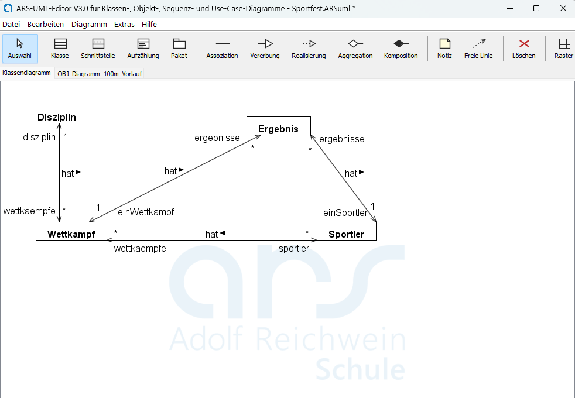
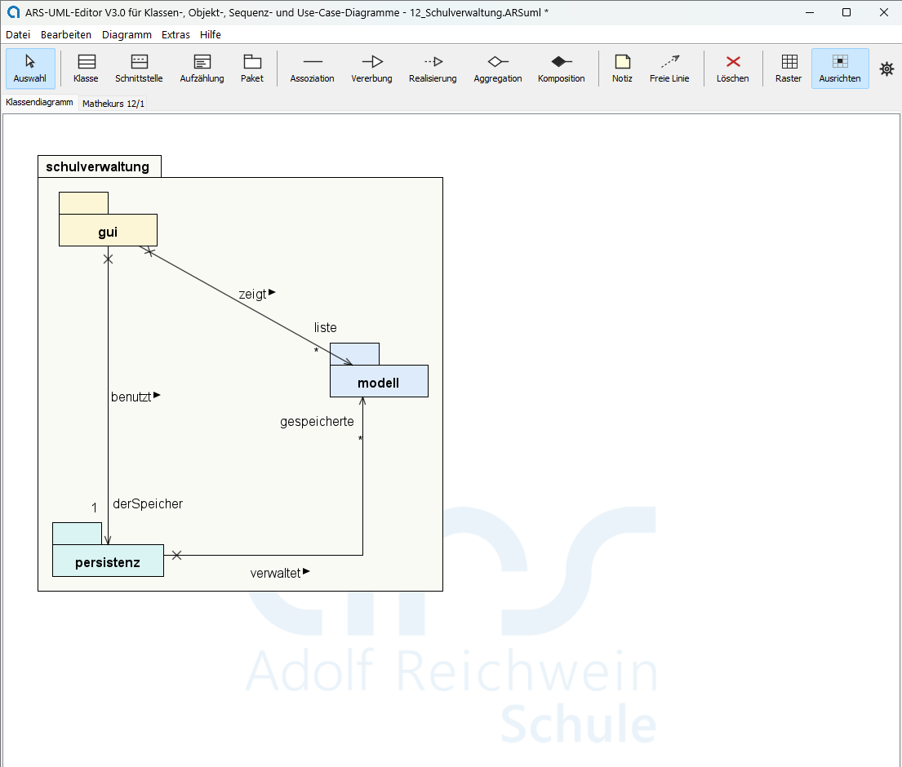

# ARS-UML-Editor

Ein Editor für **UML-Diagramme**: Klassendiagramm, Objektdiagramm,
Sequenzdiagramm und Use-Case-Diagramm — in einem Projekt, in einer Datei.

Entstanden für die Informatik im Beruflichen Gymnasium an der ARS. Läuft unter
Windows, macOS und Linux; gebraucht wird nur **Java 17 oder neuer**. Keine
Installation, kein Setup, keine Internetverbindung — der Ordner läuft auch von
einem Stick.

## Herunterladen

Das fertige Paket liegt unter **[Releases](../../releases/latest)** —
eine ZIP-Datei, auspacken, starten.

| | |
|---|---|
| Windows | `ARS-UML-Editor V3.0 starten.bat` doppelklicken |
| macOS | `ARS-UML-Editor V3.0 starten.command` doppelklicken — beim ersten Mal einmalig `chmod +x` nötig, siehe LIESMICH |
| überall | `java -jar ARS-UML-Editor-V3.0.jar` |

## Was es kann

### Klassendiagramm — und der Umschalter, der den Entwurfsschritt zeigt

Klassen mit Attributen, Methoden, Sichtbarkeiten und Datentypen; Assoziation,
Aggregation, Komposition und Vererbung, dazu Rollennamen, Multiplizitäten,
Leserichtung und Navigierbarkeit. Abstrakte Klassen und Methoden werden kursiv
gesetzt, statische unterstrichen.

**Strg+D** blendet die Attribute ein, die sich aus den Beziehungen **ergeben** —
blau gezeichnet, rot bei einem Namenskonflikt. Damit wird der Schritt von der
Analyse zum Entwurf und zum Programm sichtbar, statt behauptet zu werden:
dieselbe Beziehung einmal als Linie, einmal als Referenzattribut und im
Java-Export als Feld.

Die Ableitung folgt den Pfeilen: Ein Pfeil an einem Ende heißt, die Klasse am
anderen Ende bekommt ein Attribut; ein **X** heißt ausdrücklich keines. Der Modus
ist reine Anzeige — das Modell bleibt unverändert.

Und dasselbe Diagramm ein drittes Mal: **zugeklappt**. Über das Rechtsklickmenü
bleibt von jeder Klasse nur der Name stehen — übrig bleiben die Beziehungen, die
Rollennamen und die Multiplizitäten, also genau das, worum es beim Besprechen der
Struktur geht.

### Schnittstellen und generische Klassen

Eine **Schnittstelle** ist eine eigene Art von Kasten: `<<interface>>` steht über
dem Namen, ihre Methoden sind kursiv, und eine Klasse wird mit der **Realisierung**
daran gebunden — gestrichelte Linie, offenes Dreieck. Im Java-Export entsteht daraus
ein echtes `interface` und ein `implements`.

**Generische Klassen** tragen ihre Platzhalter im gestrichelten Kästchen oben
rechts, wie die UML es vorsieht. Datentypen wie `MyLinkedList<T>` lassen sich
überall eintragen, wo ein Typ erwartet wird. Auch der Java-Import erkennt beides
wieder.

Eine **Aufzählung** ist die dritte Art von Kasten: `<<enumeration>>` über dem
Namen, die Konstanten im Fach darunter — und im Export ein echtes `enum`.

Das Bild zeigt beides zusammen: `MyQueueInterface` legt fest, was eine
Warteschlange können muss; `ArrayQueue` und `ListQueue` erfüllen sie auf zwei
verschiedene Weisen — die eine über eine indizierte, die andere über eine
verkettete Liste. Genau der Unterschied, um den es im Unterricht geht.

### Pakete — Schichten, die man sieht

Ein **Paket** gliedert das Klassendiagramm: der Kasten mit dem Reiter, in dem
Klassen, Schnittstellen, Aufzählungen und weitere Pakete liegen. Hineingezogen
wird mit der Maus oder über das Rechtsklickmenü; das Paket wächst mit seinem
Inhalt und nimmt ihn beim Verschieben mit. Jedes bekommt auf Wunsch eine
**Hintergrundfarbe** — am Beamer ist das der Unterschied zwischen „da sind drei
Kästen" und „da sind drei Schichten".

Der Ertrag steht an den Linien **zwischen** den Paketen: Die Oberfläche kennt das
Modell und den Speicher — umgekehrt weiß das Modell von beiden nichts. Und das
`~` vor `DateiSpeicher` heißt, dass die Klasse nur in ihrem eigenen Paket sichtbar
ist: Das Hauptfenster hängt an der **Schnittstelle** `Speicher`, nicht an der
Umsetzung. Der Java-Export hält sich daran, und der Übersetzer weist einen Zugriff
von außen zurück.

**Zuklappen** macht aus demselben Diagramm eine Übersicht. Rechtsklick, und von
einem Paket bleiben Reiter und Name; die Beziehungen nach außen enden am
Paketkasten, mehrere zum selben Ziel werden zu einer zusammengefasst. Übrig bleibt
genau die Frage, um die es dann geht: Welches Paket hängt von welchem ab?

Im **Java-Export** wird aus jedem Paket ein Unterordner mit eigener
`package`-Zeile; benutzt eine Klasse eine aus einem anderen Paket, schreibt der
Editor die `import`-Zeile dazu. Der erzeugte Quelltext lässt sich übersetzen.

### Objektdiagramm

Zu jedem Klassendiagramm beliebig viele Objektdiagramme, jedes in einem eigenen
Reiter. Der Editor prüft dabei mit: Ein Objekt einer **abstrakten** Klasse gibt es
nicht, eine Verknüpfung ohne Beziehung im Klassendiagramm auch nicht, und eine
überschrittene Multiplizität wird gemeldet.

### Sequenzdiagramm

Lebenslinien mit Aktivierungsbalken, synchrone und asynchrone Nachrichten,
Antworten, Selbstaufrufe, Erzeugung und Zerstörung, dazu Fragmente
(`loop`, `alt`, `opt`, …) und Notizen. Die **Reihenfolge** der Nachrichten ist
das Modell: Sie werden mit Alt+Pfeil umsortiert, die Höhen rechnet das Programm.
Mehrere Abläufe dürfen nebeneinanderstehen — etwa Server- und Clientseite eines
Netzprogramms.

### Use-Case-Diagramm

Akteure, Anwendungsfälle, `include` und `extend` mit Bedingungszettel,
Erweiterungsstellen und Generalisierung. Der **Systemrahmen** wird nicht
gezeichnet, sondern **abgeleitet**: Er umschließt immer alle Anwendungsfälle und
lässt die Akteure außen vor — genau das, was er aussagen soll.

### Dazu

**Java-Quelltext in beide Richtungen.** Aus dem Klassendiagramm entstehen
`.java`-Dateien mit Attributen, Konstruktor und auf Wunsch Gettern und Settern.
Umgekehrt liest der Editor vorhandene `.java`-Dateien ein und zeichnet daraus ein
Klassendiagramm — mit Vererbung und Assoziationen.

**Export als PNG und als SVG.** Das Vektorbild bleibt beim Vergrößern scharf —
für Arbeitsblätter, Beamer und Ausdruck; LibreOffice und Word fügen es ein wie
jedes andere Bild. Ist etwas **ausgewählt**, wird nur dieser Ausschnitt
exportiert, eng zugeschnitten.

**Ordnung im Bild.** Elemente lassen sich aneinander **ausrichten** und mittig
setzen, ein **Raster** ein- und ausblenden und getrennt davon **einrasten**.
Beziehungslinien knicken um Kästen herum, Rollennamen und Multiplizitäten lassen
sich verschieben, und eine **freie Linie** dient als reine Anmerkung — etwa um in
einem Sequenzdiagramm zu zeigen, welche Daten zwischen zwei Aufrufen übertragen
werden.

**Dreizehn Beispielprojekte** liegen bei, von der einfachen Bank bis zu einem
Chorwettbewerb, einer Client-Server-Kommunikation und einer in Pakete gegliederten
Schulverwaltung. Jedes ist in der beiliegenden LIESMICH einzeln beschrieben —
mit dem, was sich daran zeigen lässt, und mit Fragen für den Unterricht.

**Eine ausführliche Anleitung steckt im Programm** — Taste **F1**. Sie erklärt
jedes Werkzeug, die vier Diagrammarten und die Regeln, nach denen der Editor
mitprüft.

## Für Lehrkräfte

Der Editor kennt eine **Klassenbibliothek**: fertig modellierte Klassen, die sich
mit zwei Klicks ins Diagramm holen lassen. In dieser Fassung liegt davon eine
**kleine Auswahl** bei — elf Klassen, je eine pro Sachgebiet, als Anschauung
dafür, wie eine sauber modellierte Klasse aussieht.

Die **vollständige Bibliothek mit 184 Klassen** in dreizehn Kategorien gibt es auf
Anfrage. Schreiben Sie mich an und nennen Sie Ihre Schule.

**Der Grund für die Trennung:** Attribute und Methoden aus einem Pflichtenheft
abzuleiten ist genau der Schritt, den die Schülerinnen und Schüler üben sollen.
Läge für jede Aufgabe die fertige Klasse bereit, übt ihn niemand mehr. Alles
andere kann diese Fassung uneingeschränkt — auch eigene Klassen in die Bibliothek
aufnehmen und sie als `.ARScls`-Datei weitergeben.

## Warum hier nur das Programm liegt

Der Quelltext ist nicht Teil dieser Veröffentlichung; weitergegeben werden soll
das Paket unverändert. Lehrkräfte, die für ihren eigenen Unterricht hineinsehen
möchten, dürfen mich gerne fragen. Einzelheiten in der
[Nutzungserlaubnis](LIZENZ.md).

## Lizenz

Kostenlos nutzbar und weitergebbar für Unterricht, Ausbildung und
Selbststudium; keine kommerzielle Nutzung. Siehe **[LIZENZ.md](LIZENZ.md)**.

Ohne Gewährleistung.
